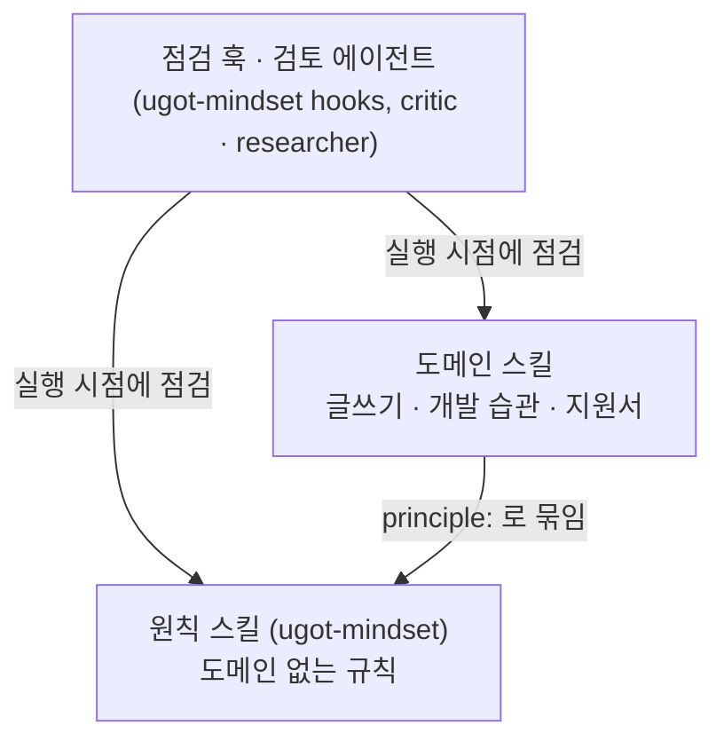

# UGOT Skills

Claude Code와 Codex에서 쓰는 UGOT의 공개 스킬 묶음입니다. 에이전트가 사용자의 의도를 읽고, 확인한 것만 말하고, 빠뜨린 것을 숨기지 않게 만드는 습관을 스킬과 훅으로 담았습니다.

Open skills from UGOT for Claude Code and Codex: agent mindset gates, reader-first writing and engineering habits. Most skill text is written in Korean.

## 플러그인

| 플러그인 | 내용 |
|---|---|
| `ugot-mindset` | 의도 읽기, 첫 도구 호출 전에 요구를 ID로 적기, 확인 전 주장 금지, 설명은 그림 먼저, 나쁜 숫자는 자부터 의심, "불가능" 전에 고칠 사다리 오르기, 끝까지 하기, 짧은 사람 말 답변. 스킬 30개, 에이전트 2개, 자동 점검 훅 |
| `ugot-writing` | 독자 중심 글쓰기, 문체 편집, 지원서 최종 확인, 노래·가사, 이야기 구성, 짧은 광고 |
| `ugot-engineering-habits` | 근본 원리부터 구현, 최신 문헌 확인, 지름길을 숨기지 않기, 사전 부검, 치명적인 것부터, 장애는 수습과 근본 수정을 나누고 재발을 원인 단위로 확인 |

## 구조

스킬은 세 층으로 나뉘고, 의존은 바깥에서 안쪽으로만 흐릅니다. 원칙 스킬 설명에 결합된 도메인 스킬 이름이 예로 나오기도 하지만, 원칙의 절차는 그 스킬 없이 성립합니다.



- **원칙 스킬**은 도메인이 없는 규칙입니다. 예를 들어 `spec-first`는 일을 시작하기 전에 요구를 ID로 적고, 끝에서 요구마다 증거 또는 빠진 이유를 남기게 합니다. 머리말에 `principle: self`라고 적고, `ugot-mindset`에만 둡니다.
- **도메인 스킬**은 원칙 하나를 특정 일에 적용한 절차입니다. 머리말의 `principle: <원칙 이름>`으로 어느 원칙을 실행하는지 밝힙니다. 예를 들어 지원서 최종 확인은 `safe-process-control`을, 장애 수정은 `fundamental-first`를 실행합니다. 새 도메인이 생기면 원칙을 새로 만들지 않고 결합을 하나 더합니다.
- **계약**은 스킬 머리말의 `contract:`입니다. 언제 켜는지(trigger), 무엇을 하는지(procedure), 끝났다는 증거의 형태(exit_check), 남길 산출물(evidence)을 적습니다. 일부 원칙은 막으려는 실수 번호(failure_modes)와 기계로 확인할 조건(validator)도 적습니다. 검토 에이전트는 이 계약을 판정 기준으로 쓸 수 있습니다.
- **훅**은 요청을 받을 때, 명령 실행 전후, 턴을 끝낼 때 점검 문구를 넣거나 막습니다. 패턴으로 프로세스를 죽이는 명령은 실행 전에 막습니다. 허락 질문으로 멈추기, 빠진 것을 밝히지 않은 완료 선언, 만든 것 없이 "나중에"로 끝내기는 턴 끝에 막습니다. 턴 끝 검사 셋은 답의 글을 정규식으로 봅니다.

층 규칙은 `tools/check_layers.py`가 검사합니다. 모든 스킬이 원칙에 묶였는지, 묶인 원칙이 이 저장소에 있는지, 원칙 스킬이 `ugot-mindset` 밖에 없는지를 봅니다. 지금 값은 스킬 51개 중 50개가 묶였고, `apply-for-jobs`는 아직 결합이 없습니다.

내부 원본에는 이 위에 두 층이 더 있습니다. 하나는 상황마다 켤 스킬을 고르는 경로 그래프이고, 다른 하나는 요구와 스킬 적용을 턴마다 적는 작업 장부입니다. 둘은 내부 도구에 기대므로 아직 공개하지 않았습니다. 내부판 훅은 그 장부와 계약의 validator로 요구 충족을 확인하고, 완료 선언 정규식 차단은 알림으로 낮췄습니다. 공개판 훅은 장부 없이 동작하는 이전 판입니다.

## 설치

**Claude Code**

```
/plugin marketplace add edu-ide/ugot-skills
/plugin install ugot-mindset@ugot-skills
```

**Codex**

```bash
codex plugin marketplace add https://github.com/edu-ide/ugot-skills.git
codex plugin add ugot-mindset@ugot-skills
```

Codex에서도 스킬이 동작합니다(Codex 0.160 확인). `ugot-mindset`의 훅은 Claude Code 형식이며, Codex에서 실행되는지는 아직 확인하지 않았습니다.

## 만든 곳

UGOT은 AI가 한 일을 믿을 수 있게 기록하고 확인하는 도구를 만듭니다. 문서(Office), 업무 기록(Work), 기억(Brain), 브라우저(Agent Browser), 메일 도구는 [space.ugot.uk](https://space.ugot.uk)에서 볼 수 있습니다.

## 기여와 라이선스

이 저장소는 UGOT 내부 원본에서 공개 허용 목록(`tools/public-allowlist.json`)만 복사해 만듭니다. 고칠 점은 이슈로 알려 주세요.

MIT License. `LICENSE`를 보세요.
