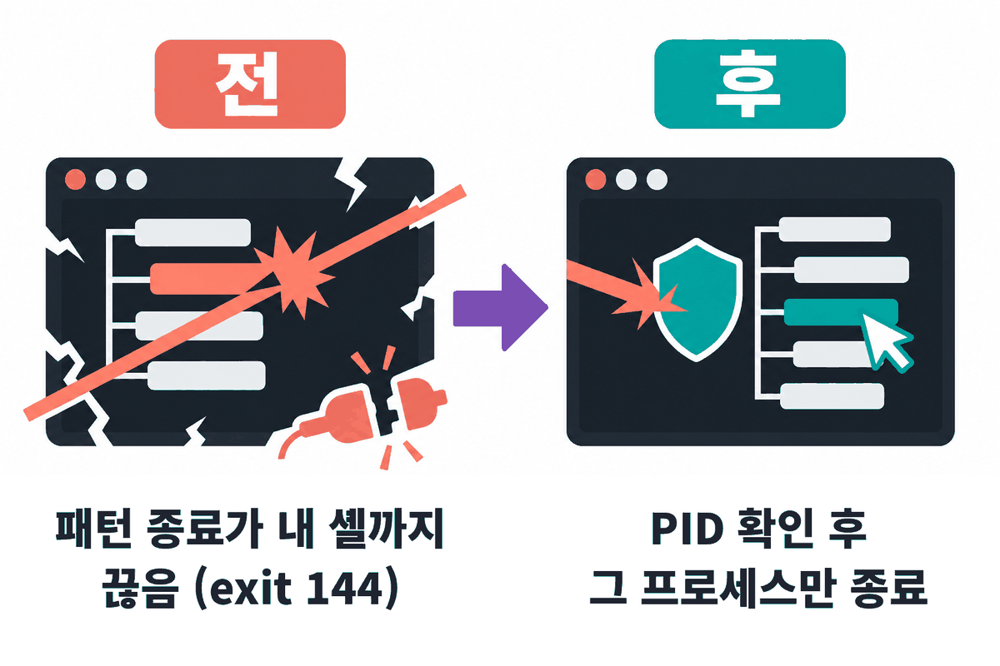
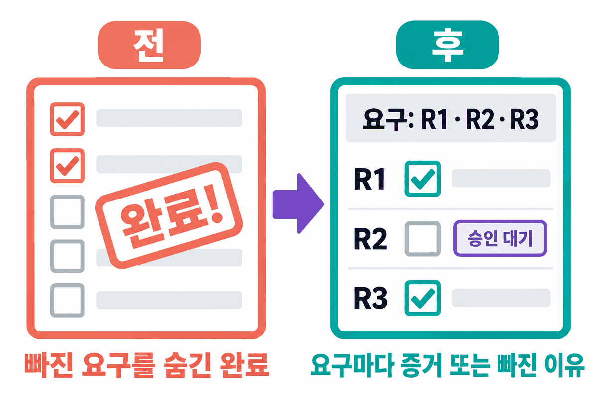
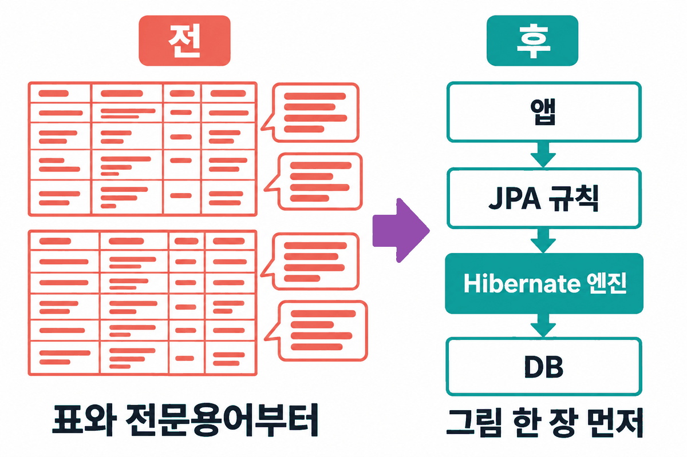
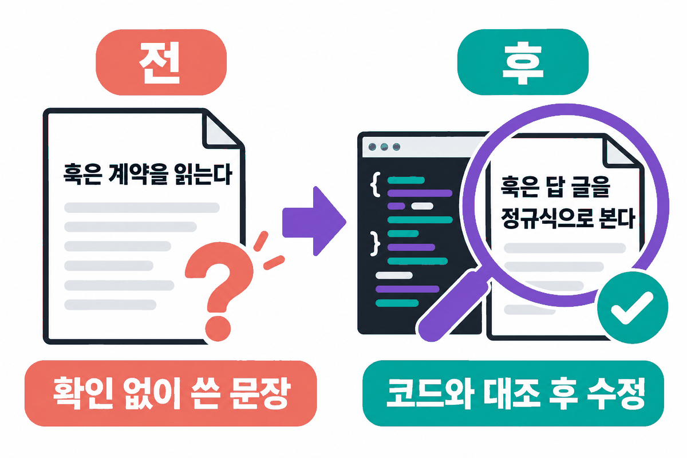
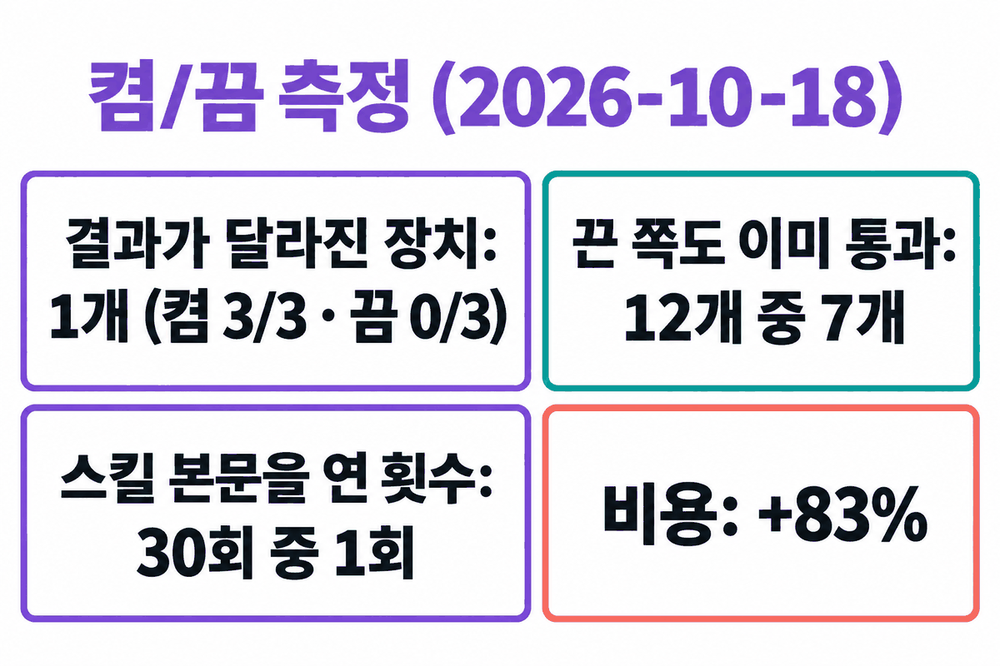
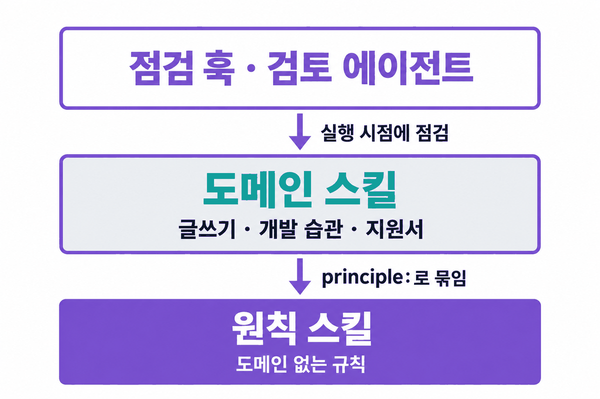
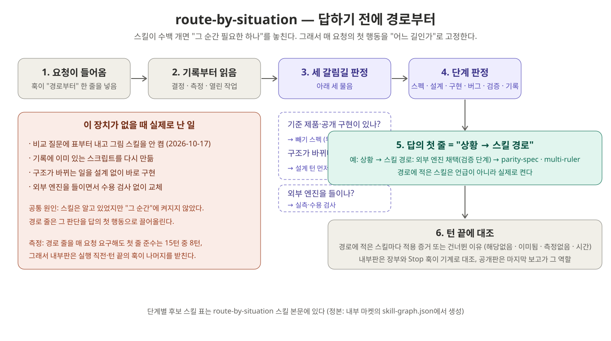
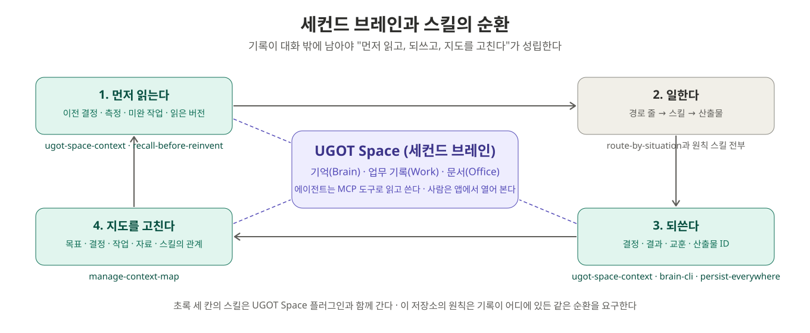
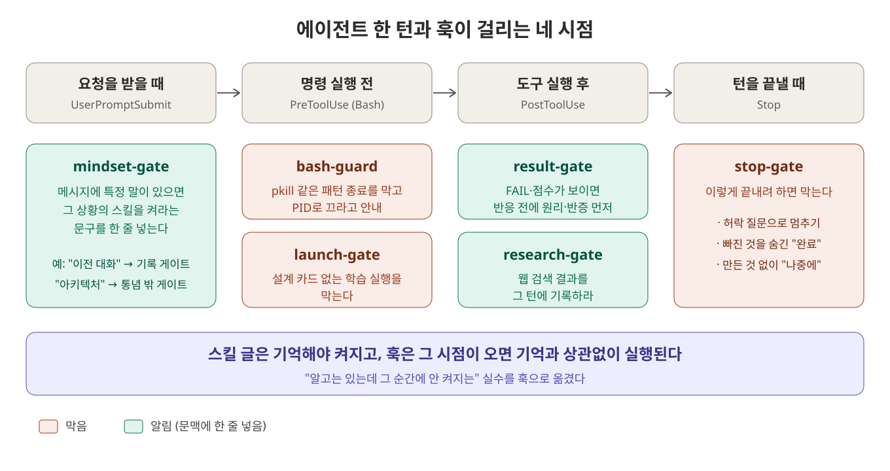

# UGOT Skills

Claude Code와 Codex에서 쓰는 UGOT의 공개 스킬 묶음입니다. 에이전트가 사용자의 의도를 읽고, 확인한 것만 말하고, 빠뜨린 것을 숨기지 않게 만드는 습관을 스킬과 훅으로 담았습니다.

Open skills from UGOT for Claude Code and Codex: agent mindset gates, reader-first writing and engineering habits. Most skill text is written in Korean.

## 플러그인

| 플러그인 | 내용 |
|---|---|
| `ugot-mindset` | 답하기 전에 "상황 → 스킬 경로" 한 줄(`route-by-situation`), 의도 읽기, 첫 도구 호출 전에 요구를 ID로 적기, 확인 전 주장 금지, 설명은 그림 먼저, 나쁜 숫자는 자부터 의심, "불가능" 전에 고칠 사다리 오르기, 끝까지 하기, 짧은 사람 말 답변. 스킬 31개, 에이전트 2개, 자동 점검 훅 |
| `ugot-writing` | 독자 중심 글쓰기, 문체 편집, 지원서 최종 확인, 노래·가사, 이야기 구성, 짧은 광고, 주장마다 근거 주석 달기(`criticmarkup`), 스킬 사본에 요구별 이행 기록(`skill-run`) |
| `ugot-engineering-habits` | 근본 원리부터 구현, 최신 문헌 확인, 지름길을 숨기지 않기, 사전 부검, 치명적인 것부터, 장애는 수습과 근본 수정을 나누고 재발을 원인 단위로 확인 |

## 써 보면 무엇이 달라지나

아래 사례는 이 스킬을 만든 사람의 실제 작업 기록에서 골랐습니다. "전"은 사용자가 실제로 짚은 실수이고, 따옴표 안은 그때 사용자가 한 말입니다. "후"는 스킬이 생긴 뒤 같은 상황에서 남은 기록입니다. 한 사람의 기록이므로 효과의 증명이 아니라 무엇이 어떻게 바뀌는지 보여 주는 예입니다. 통제된 측정 결과는 사례 다음에 따로 적었습니다.

**1. 프로세스를 패턴으로 죽이기** (`safe-process-control`, 훅 `bash-guard`)



- 전: `pkill -f <패턴>`으로 띄운 서버를 끄다가, 같은 패턴이 든 에이전트 자신의 셸까지 죽였습니다(종료 코드 144). 뒤따르던 정리 명령이 돌지 않았고, 2026-09-25와 2026-10-12에 같은 일이 되풀이됐습니다.
- 후: 훅이 실행 전에 막고, 명령줄과 시작 시각으로 PID를 확인한 뒤 그 PID만 끄라고 안내합니다. 2026-10-19에는 파일 이름에 `pkill`이 든 읽기 명령까지 막았습니다. 이것은 오탐이고, 파일 이름을 바꿔 부르면 지나갑니다.

**2. 빠뜨리고 "완료"라고 하기** (`spec-first`)



- 전: 요구 일부를 빼고 끝냈다고 보고했습니다. 사용자는 "이런 식으로 또 누락시키네 은밀하게", "진짜 누락 없지?"라고 물었습니다.
- 후: 일을 받으면 첫 도구 호출 전에 `요구: R1 …; R2 …`를 적습니다. 끝에서는 요구마다 증거나 빠진 이유를 남깁니다. 2026-10-19 이 저장소에 스킬을 올릴 때도 이 방식을 썼습니다. 공개 푸시는 되돌리기 어려워 그 요구만 "R2 승인 대기"로 보고했고, 사용자가 승인한 뒤에 올렸습니다.

**3. 설명을 표와 전문용어로 시작하기** (`visual-first`)



- 전: 2026-10-17 "JPA를 JDBC나 jOOQ로 바꾸면 쿼리 추상화가 안 되냐"는 질문에 비교표 두 개와 전문용어부터 냈습니다. 바꾸자는 이유(엔진이 메모리를 먹는다)는 끝내 말하지 않았습니다. 사용자는 "왜 나에게 설명이 불친절해"라고 했습니다.
- 후: 같은 내용을 "앱 → JPA 규칙 → Hibernate 엔진 → DB" 층 그림으로 다시 설명했습니다. 선택지마다 무엇이 빠지는지를 그림 위에 겹쳐 그렸습니다. 다만 아래 측정의 짧은 과제에서는 스킬을 켜도 그림이 나오지 않았습니다(0/3).

**4. 확인하지 않고 문서에 쓰기** (`doubt-and-verify`, `faithful-first`)



- 전: 2026-10-19 이 README의 구조 절 초안에 내부판 설계를 그대로 옮겨 "훅은 계약을 읽는다"고 썼습니다.
- 후: 커밋 전에 공개판 훅 코드와 대조했습니다. 공개판 훅은 계약을 읽지 않고 답 글을 정규식으로 본다는 것을 확인했고, 그 문장을 고쳤습니다. 같은 날 층 검사 스크립트(`tools/check_layers.py`)는 앞서 공개된 판에서 원칙 결합 오류 1건을 찾았습니다. 원인은 커밋되지 않은 작업이 동기화에 섞인 것이었고, 커밋 `32e4680`에서 고쳤습니다.

**측정: 켰을 때와 껐을 때** (2026-10-18, `claude plugin eval`, 에이전트 Sonnet, 사례마다 3회)



옛 실수를 재현하도록 만든 짧은 과제 12개로 비교했습니다. 대부분은 플러그인을 켠 쪽과 끈 쪽을, 넷은 규칙이 들어오기 전 판과 뒤 판을 비교했습니다.

| 결과 | 값 |
|---|---|
| 결과가 달라진 장치 | 내부판 일정 게이트 1개 (켬 3/3, 끔 0/3) |
| 끈 쪽이나 이전 판도 이미 통과한 사례 | 12개 중 7개 |
| 켠 쪽에서 스킬 본문을 연 횟수 | 30회 중 1회 |
| 비용 | 켬이 끔보다 83% 많음 |

- **짧은 과제**: 짧고 깨끗한 과제에서는 모델이 스킬 없이도 옛 실수를 대부분 하지 않았습니다. 그래서 대부분 스킬의 효과는 이 측정으로 잴 수 없었습니다.
- **긴 실제 대화**: 실제 대화를 이어 붙인 긴 사례에서는 끈 쪽이 3번 모두 결정을 사용자에게 되넘겼습니다. 켠 쪽도 결정 행동은 0/3으로 같았고, 끝맺음 말만 바뀌었습니다. 이 실수(`keep-going`이 겨냥한 것)는 아직 못 고쳤습니다.
- **해**: 턴 끝 차단은 에이전트가 한 마디를 더 하게 만듭니다. 그 말이 마지막 답이 되면 앞의 결론이 덮였습니다. 머리 없는 실행에서는 이것이 실제 손해였고, 내부판 0.8.27에서 "앞 답을 다시 쓰고 게이트 항목은 아래에"로 고쳤습니다.

## 구조

스킬은 세 층으로 나뉘고, 의존은 바깥에서 안쪽으로만 흐릅니다. 원칙 스킬 설명에 결합된 도메인 스킬 이름이 예로 나오기도 하지만, 원칙의 절차는 그 스킬 없이 성립합니다.



- **원칙 스킬**은 도메인이 없는 규칙입니다. 예를 들어 `spec-first`는 일을 시작하기 전에 요구를 ID로 적고, 끝에서 요구마다 증거 또는 빠진 이유를 남기게 합니다. 머리말에 `principle: self`라고 적고, `ugot-mindset`에만 둡니다.
- **도메인 스킬**은 원칙 하나를 특정 일에 적용한 절차입니다. 머리말의 `principle: <원칙 이름>`으로 어느 원칙을 실행하는지 밝힙니다. 예를 들어 지원서 최종 확인은 `safe-process-control`을, 장애 수정은 `fundamental-first`를 실행합니다. 새 도메인이 생기면 원칙을 새로 만들지 않고 결합을 하나 더합니다.
- **계약**은 스킬 머리말의 `contract:`입니다. 언제 켜는지(trigger), 무엇을 하는지(procedure), 끝났다는 증거의 형태(exit_check), 남길 산출물(evidence)을 적습니다. 일부 원칙은 막으려는 실수 번호(failure_modes)와 기계로 확인할 조건(validator)도 적습니다. 이 다섯 칸 구성은 SkillOps([arXiv 2605.13716](https://arxiv.org/abs/2605.13716))의 스킬 계약에서 가져왔습니다. 검토 에이전트는 이 계약을 판정 기준으로 쓸 수 있습니다.
- **근거 주석**은 문서의 주장 바로 뒤에 출처·위치·뒷받침 범위를 [CriticMarkup](https://github.com/CriticMarkup/CriticMarkup-toolkit) 주석으로 다는 방식입니다. 확인하지 못한 주장은 미확인이라고 적습니다. 절차는 `criticmarkup` 스킬에 있고, 그 스킬 본문에서 실제 예를 볼 수 있습니다.

  ```text
  CriticMarkup의 주석 표기는 `{>> <<}`다. {>>근거: 유형=사실; 출처=[공식 문법][syntax]; 위치=The Basic Syntax 및 Comments; 확인=2026-10-15; 연결=주석의 여는 표식과 닫는 표식<<}
  ```

  내부 원본의 스킬에도 이런 주석이 있지만, 대부분 비공개 자료를 가리켜서 공개판에서는 뺐습니다. 공개 출처를 가리키는 주석만 남깁니다.

  같은 표기를 작업 중에 쓰는 스킬이 `skill-run`입니다. 적용할 스킬을 시각별 작업 폴더에 복사하고, 작업용 사본의 요구사항 바로 뒤에 읽음·실행·검증·근거를 주석으로 남깁니다. 원본은 건드리지 않고, 다음 행동 전에 선행 조건을 사본에서 대조합니다. 두 스킬은 `doubt-and-verify`(근거 주석)와 `spec-first`(이행 기록)를 문서 도메인에서 실행하는 짝입니다.
- **훅**은 요청을 받을 때, 명령 실행 전후, 턴을 끝낼 때 점검 문구를 넣거나 막습니다. 패턴으로 프로세스를 죽이는 명령은 실행 전에 막습니다. 허락 질문으로 멈추기, 빠진 것을 밝히지 않은 완료 선언, 만든 것 없이 "나중에"로 끝내기는 턴 끝에 막습니다. 턴 끝 검사 셋은 답의 글을 정규식으로 봅니다.

층 규칙은 `tools/check_layers.py`가 검사합니다. 모든 스킬이 원칙에 묶였는지, 묶인 원칙이 이 저장소에 있는지, 원칙 스킬이 `ugot-mindset` 밖에 없는지를 봅니다. 지금 값은 스킬 52개 중 51개가 묶였고, `apply-for-jobs`는 아직 결합이 없습니다.

내부 원본에는 이 위에 두 층이 더 있습니다. 하나는 상황마다 켤 스킬을 고르는 경로 그래프이고, 다른 하나는 요구와 스킬 적용을 턴마다 적는 작업 장부입니다. 둘은 내부 도구에 기대므로 아직 공개하지 않았습니다. 내부판 훅은 그 장부와 계약의 validator로 요구 충족을 확인하고, 완료 선언 정규식 차단은 알림으로 낮췄습니다. 공개판 훅은 장부 없이 동작하는 이전 판입니다.

## 경로부터: route-by-situation



스킬이 수백 개가 되면 문제는 스킬의 질이 아니라 "그 순간 필요한 하나를 켜는 것"입니다. `route-by-situation`은 그 판단을 매 요청의 첫 행동으로 고정하는 스킬이고, 이 묶음에서 스킬 누락을 막는 가장 중요한 장치입니다.

- **무엇을 하나.** 요청을 받으면 먼저 기록을 읽고, 세 갈림길을 판정합니다. 기준 제품이나 공개 구현이 있나(있으면 무엇이 빠졌는지 적는 빼기 스펙), 구조가 바뀌나(바뀌면 설계 턴 먼저), 외부 엔진을 들이나(들이면 실측과 수용 검사). 그다음 단계(스펙·설계·구현·버그·검증·기록)를 고르고, 답의 첫 줄에 `상황 → 스킬 경로: …` 한 줄을 씁니다. 경로에 적은 스킬은 언급이 아니라 실제로 켭니다.
- **왜 첫 줄인가.** 이 장치가 없을 때 실제로 난 일은 전부 "스킬은 알았지만 그 순간에 안 켜진" 경우였습니다. 비교 질문에 표부터 내고 그림 스킬을 안 켜고, 기록에 이미 있는 스크립트를 다시 만들고, 구조가 바뀌는 일을 설계 없이 바로 구현했습니다. 경로 줄은 그 판단을 글의 맨 앞으로 끌어올립니다.
- **훅이 받칩니다.** `mindset-gate`가 매 요청 "경로부터"를 상기시킵니다. 그래도 측정에서 첫 줄 준수는 15턴 중 8턴이었습니다. 그래서 내부판은 도구 실행 직전과 턴 끝의 훅이 나머지를 받치고, 경로에 적은 스킬마다 적용 증거를 장부로 대조합니다. 공개판에서는 마지막 보고의 "적용 / 건너뜀(이유)" 목록이 그 역할입니다.
- **후보 표.** 단계별 후보 스킬 표는 스킬 본문에 있습니다. 공개판 표에는 이 저장소에 있는 스킬만 보이고, 내부판 표에는 개발·연구 스킬이 더 있습니다.

## 원칙 스킬 목록

`ugot-mindset`의 원칙 스킬 30개입니다. 전부 도메인이 없는 규칙이고, 머리말에 `principle: self`가 있습니다. 여기에 `human-understands`에 묶인 실행 스킬 `visual-first` 하나를 자주 쓰여 함께 적었습니다. 괄호는 그 원칙이 생긴 실제 지적입니다.

**요청을 읽을 때**

- `route-by-situation` — 답하기 전에 "상황 → 스킬 경로" 한 줄. 위 절.
- `read-the-intent` — 짧은 말·생략된 말을 문자 그대로 집행하지 않고 앞 맥락까지 읽어 의도를 먼저 잡는다.
- `question-the-task-first` — 일을 넘겨받을 때, 빨리 하라는 압박이 올 때 "이 일이 맞는 일인가"를 먼저 묻는다.
- `spec-first` — 첫 도구 호출 전에 요구를 ID로 적고, 끝에서 요구마다 증거 또는 빠진 이유를 남긴다("이런 식으로 또 누락시키네").
- `recall-before-reinvent` — 새로 만들거나 "없다"고 말하기 전에 기록·장부·기존 코드를 먼저 찾는다("이미 했던 거 또?").
- `reference-first` — 손대기 전에 누가 이미 풀었고 1차 자료는 뭐라 하는지 네 갈래로 확인하고 참고 줄을 쓴다.

**만들 때**

- `design-turn-first` — 새 모듈·엔진 교체 전에 소유권·의존·불변식·검사를 먼저 정하는 설계 턴을 둔다.
- `predictability-first` — 예측할 수 없는 부품을 만들지 않는다. 예측표를 먼저 내고 비예측 칸을 줄인다.
- `one-source-of-truth` — 같은 것을 만드는 두 번째 생산자·사본을 만들지 않고 정본을 확장한다.
- `add-without-breaking` — 새것을 넣을 때 기존 것이 무너지지 않음을 같은 시험대에서 함께 확인한다.
- `faithful-first` — 진짜 방법과 검증된 경로로 만들고, 단순화했다면 넘길 때 먼저 밝힌다.
- `solve-first` — 도구의 한계에 막혀도 "불가능"으로 끝내지 않는다. 설정 → 확장점 → 패치·포크 → 교체 사다리를 오른다("자꾸 불가능하다만 이야기함").
- `fundamental-first` — 우회책을 채택하기 전에 근본 원인부터 측정으로 진단한다("그건 근본 해결이 아니잖아").
- `no-waste` — 이미 있는 결과·코드·기준선을 재계산하지 않고, 같은 기능을 중복 생성하지 않는다.
- `safe-process-control` — 프로세스는 PID로만 끈다. 패턴 일괄 종료 금지(자기 셸을 죽인 사고 6회 이상).

**확인할 때**

- `doubt-and-verify` — "된다/완료"라고 말하기 전에 실제 확인으로 검증하고 VERIFIED와 UNVERIFIED를 나눠 말한다.
- `real-input-real-check` — 내가 만든 픽스처·점수표로는 "된다"를 말하지 않는다. 실제 입력으로 돌리고 실제 출력을 본다.
- `blame-the-instrument-first` — 나쁜 숫자가 나오면 결론보다 먼저 자·조건·틀을 의심한다.
- `multi-ruler` — 단일 점수로 판정·폐기하지 않고 여러 자 위에 후보를 나란히 놓는다("항상 다중 자로 해야 되는 거 아니야?").
- `multi-axis-thinking` — 결정 전에 일곱 축(목표·원리·증거·선행·대안·반증·비용)을 한 줄씩 놓고 셋 이상이 같은 쪽일 때만 움직인다.
- `pro-quality` — 문서·화면·코드는 미리보기로 직접 보고 나서 "됐다"고 한다.
- `sprout-loop` — 실험을 발사하면 즉시 감시를 걸고 사전 등록한 기준으로 가장 이른 시점에 판정한다.
- `honest-eta` — 시간은 실측. 지금 시각을 재고 관측된 속도로 계산해 구간으로 말한다.

**말할 때**

- `answer-briefly` — 결론 먼저, 3줄 이내("왜 이렇게 말이 길어").
- `speak-human` — 동료에게 설명하듯 사람 말로. 장부 번호·기호·전문용어 없이.
- `visual-first` (human-understands의 실행 스킬) — 구조·흐름·비교·원인 사슬은 글보다 그림 한 장을 먼저("왜 나에게 설명이 불친절해").
- `human-understands` — 사고는 에이전트가 해도 이해와 결정은 사람이 한다. 방향이 갈릴 때, 예상과 다를 때 사람이 이해할 수 있게 남긴다.
- `keep-going` — 권한을 받았으면 허락 질문으로 멈추지 않고 끝까지. 되돌릴 수 없는 일만 확인("너가 해, 왜 자꾸 나한테 하래").

**스스로 고칠 때**

- `mistake-review` — 반복 실수 점검표로 일을 받을 때·결과를 읽을 때·완료 선언 전에 점검한다.
- `improve-governing-rules` — 참고 규칙이 목적과 충돌하면 교체 문구가 든 개정안을 제안한다.
- `persist-everywhere` — 결론·교훈·결정을 메모리에만 두지 않고 저장소·지식망·작업 기록 세 곳에 남긴다("메모리만 업데이트하면 안 돼").

내부판에는 여기 없는 원칙이 더 있습니다. 스킬 자체를 고치는 `rsi-loop`와, 아래 세컨드 브레인 절의 스킬들입니다.

## 세컨드 브레인과 함께 쓰기



이 스킬들이 전제하는 것이 하나 있습니다. 에이전트가 읽고 쓰는 기록이 대화 밖에 남아야 한다는 것입니다. `recall-before-reinvent`는 기록을 먼저 찾으라 하고, `persist-everywhere`는 결론을 세 곳에 남기라 하고, `route-by-situation`은 기록부터 읽고 경로를 정하라 합니다. 그 기록이 사는 곳이 UGOT Space입니다. 기억(Brain), 업무 기록(Work), 문서(Office)를 한 곳에 두는 세컨드 브레인 제품이고, 에이전트는 MCP 도구로 읽고 씁니다.

세컨드 브레인을 다루는 스킬은 셋이고, 제품 플러그인과 함께 갑니다. 이 저장소에는 없습니다.

- `ugot-space-context` — 이전 결정·선호·파일·미완 작업에 의존하는 일을 시작할 때 Space에서 정본과 실제로 읽은 버전을 확인하고, 끝나면 결정·결과·교훈을 Space에 되씁니다. 읽은 항목과 되쓴 항목의 ID가 남아야 끝난 것으로 칩니다. `recall-before-reinvent`의 Space 실행판입니다.
- `brain-cli` — 지난 프로젝트 기억과 에이전트 대화를 찾고, 남길 만한 발견과 산출물을 저장하고, 출처를 Work 작업에 정확히 연결합니다. MCP가 안 붙은 세션에서는 같은 도구를 셸 명령으로 부릅니다.
- `manage-context-map` — 전체 목표·확정 결정·열린 작업·자료·스킬의 관계 지도를 보고, 달라진 연결만 갱신합니다. 복잡한 작업을 다시 잡을 때, 문맥이 끊겼을 때, 고아 문서나 충돌하는 원칙이 보일 때 씁니다. 갱신된 지도의 변경분이 있고 고아와 충돌이 0이어야 끝입니다.

세 스킬이 없어도 이 저장소의 원칙은 성립합니다. 기록이 어디에 있든 "먼저 읽고, 끝나면 되쓰고, 관계가 바뀌면 지도를 고친다"는 같습니다. 다만 그 기록을 사람이 다시 열어 보고 검토자가 판정할 수 있으려면 저장소 밖의 한 곳이 필요하고, 우리는 그 자리에 Space를 둡니다. 제품은 [space.ugot.uk](https://space.ugot.uk)에 있습니다.

## 훅이 하는 일



스킬은 에이전트가 기억해야 켜집니다. 그런데 실수는 대개 "알고는 있는데 그 순간에 안 켜져서" 납니다. 그래서 `ugot-mindset`은 자주 되풀이된 실수를 Claude Code 훅으로 옮겼습니다. 훅은 정해진 시점이 오면 기억과 상관없이 실행됩니다. 그림의 빨간 칸은 행동을 막고, 초록 칸은 그 자리에 점검 문구를 한 줄 넣습니다.

| 시점 | 훅 이벤트 | 훅 | 하는 일 |
|---|---|---|---|
| 요청을 받을 때 | `UserPromptSubmit` | `mindset-gate` | 메시지에 특정 말이 있으면 그 상황의 스킬을 켜라는 문구를 넣습니다 |
| 명령 실행 전 | `PreToolUse` (Bash) | `bash-guard` | `pkill -f`처럼 패턴으로 프로세스를 끄는 명령을 막습니다 |
| 명령 실행 전 | `PreToolUse` (Bash) | `launch-gate` | 설계 카드 없이 학습을 시작하는 명령을 막습니다 |
| 도구 실행 후 | `PostToolUse` (Bash) | `result-gate` | 결과에 실패나 점수가 보이면 반응하기 전에 원리와 반증을 먼저 적게 합니다 |
| 도구 실행 후 | `PostToolUse` (웹 검색) | `research-gate` | 조사 결과를 그 턴에 기록하게 합니다 |
| 턴을 끝낼 때 | `Stop` | `stop-gate` | 허락 질문으로 멈추기, 빠진 것을 숨긴 "완료", 만든 것 없이 "나중에"로 끝내기를 막습니다 |

**실제로 걸린 예** (2026-10-19, 이 저장소를 만드는 작업 중)

- **요청을 받을 때**: "이전 대화 내역 실제 사례를 근거 들어서"라는 요청에 "이전 대화"가 들어 있어 기록 게이트와 근본론·방향 게이트가 함께 걸렸습니다. 에이전트는 새로 쓰기 전에 과거 기록과 측정 결과부터 찾았고, 위 "써 보면 무엇이 달라지나"의 사례와 수치가 그렇게 모였습니다.
- **명령 실행 전**: 그림 생성 프롬프트에 "pkill"이라는 단어가 들어 있어 `bash-guard`가 명령을 막았습니다. 실제로 프로세스를 끄는 명령이 아니었으니 오탐입니다. 프롬프트를 파일로 먼저 쓰는 방식으로 지나갔습니다.
- **도구 실행 후** (코드 기준 설명): 테스트 결과에 `3 failed`가 나오면 `result-gate`가 결과 바로 뒤에 "숫자에 바로 반응하지 말 것. 원리 · 대안 설명 2개 · 반증을 먼저 적어라"를 넣습니다.

**mindset-gate가 보는 말**

| 게이트 | 메시지에 이런 말이 있으면 | 켜는 스킬 |
|---|---|---|
| 근본론·방향 먼저 | 빨리, 성과, 이어서, 이전 대화, 방향, 뭐부터, 진행해 | `question-the-task-first` |
| 진행 확인 | 짧은 "뭐 해", "어디까지", "왜 멈췄어" | 한 줄 보고 후 하던 일 계속 |
| 다중 자 | 지표 바꿔, 평가 기준, 제일 잘 된 | `multi-ruler` |
| 싹수 루프 | 진척, 결과 나왔, 언제 끝 | `sprout-loop` |
| 기록 | 이전에, 이미 했, 확인해 봐 | `recall-before-reinvent` |
| 품질 | 제대로, 대충, 퀄리티, 깨졌 | `pro-quality` |
| 지시 재확인 | 시킨 일, 엉뚱, 옆길 | `read-the-intent` |
| 중단 | 너가 해, 권한 줬, 끝까지 | `keep-going` |
| 통념 밖 | 아키텍처, 설계 카드, 새로운 구조 | 바꾸는 수준과 가장 가까운 선행 연구부터 적기 |

**한계.** `mindset-gate`는 메시지의 단어만 봅니다. 그래서 단어 없이 같은 상황이 오면 놓칩니다. 예를 들어 비교를 묻는 질문에 "그림"이라는 말이 없으면 `visual-first`가 켜지지 않아, 에이전트가 표만으로 답한 일이 여러 번 있었습니다. 답에 표가 들어간 모양을 보고 잡는 장치는 내부판에서 오탐률을 재는 중이고, 공개판에는 아직 없습니다. 턴 끝 검사도 답의 글을 정규식으로 보기 때문에 말투만 바꾼 우회는 못 잡습니다.

## 설치

**Claude Code**

```
/plugin marketplace add edu-ide/ugot-skills
/plugin install ugot-mindset@ugot-skills
```

**Codex**

```bash
codex plugin marketplace add https://github.com/edu-ide/ugot-skills.git
codex plugin add ugot-mindset@ugot-skills
```

Codex에서도 스킬이 동작합니다(Codex 0.160 확인). `ugot-mindset`의 훅은 Claude Code 형식이며, Codex에서 실행되는지는 아직 확인하지 않았습니다.

## 만든 곳

UGOT은 AI가 한 일을 믿을 수 있게 기록하고 확인하는 도구를 만듭니다. 문서(Office), 업무 기록(Work), 기억(Brain), 브라우저(Agent Browser), 메일 도구는 [space.ugot.uk](https://space.ugot.uk)에서 볼 수 있습니다.

## 기여와 라이선스

이 저장소는 UGOT 내부 원본에서 공개 허용 목록(`tools/public-allowlist.json`)만 복사해 만듭니다. 고칠 점은 이슈로 알려 주세요.

MIT License. `LICENSE`를 보세요.
